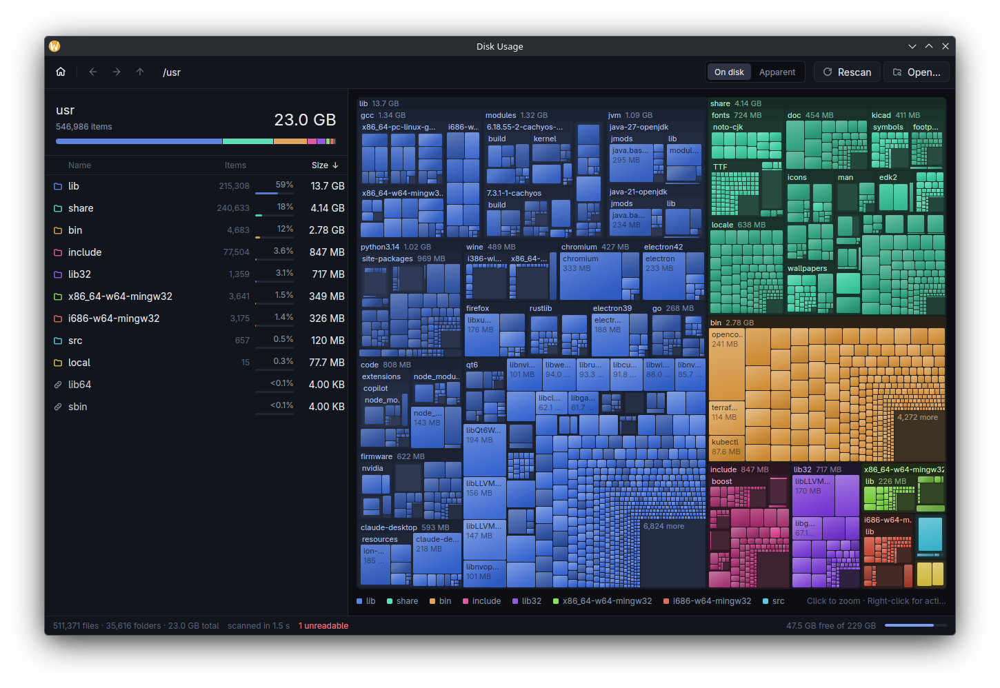
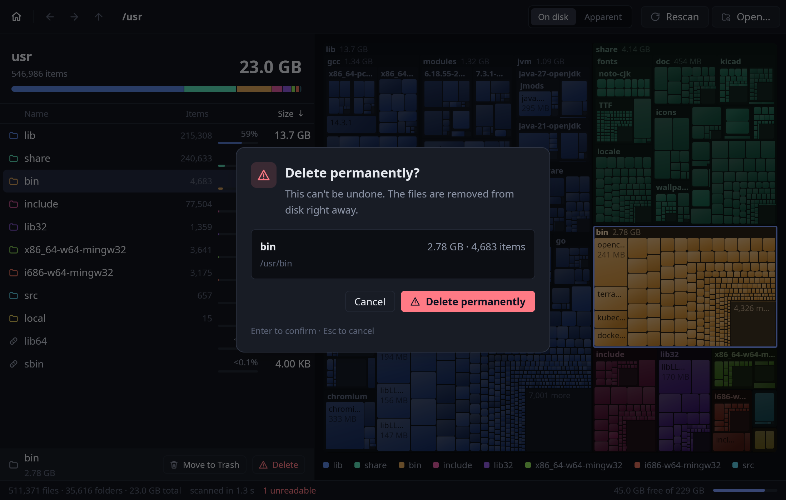

# Disk Usage

A fast disk usage analyzer for Linux, written in Rust on
[GPUI Fast](https://github.com/trevortomlin/gpui-fast).





## Features

- **Fast scanning.** Talks to the kernel directly (`getdents64`, `fstatat`, optional
  io_uring `statx`) on a parallel walker tuned per device. Hard links are counted
  once, and by default the scan stays on one filesystem. See [Performance](#performance).
- **Nested treemap.** A squarified treemap drawn straight to the GPU. Each top-level
  folder gets its own color, and chains of folders that hold only one folder are
  folded into a single header (`src / Windows / Win32`). Tiny items are merged into a
  "N more" tile, so drawing stays fast even for huge trees.
- **The list and the treemap stay in sync.** Hover a row to spotlight that item in the
  map. Hover a tile to highlight its row and see its size in a floating card.
- **Easy to navigate.** Click a tile to zoom in. Use the breadcrumbs, back/forward
  (mouse side buttons work too), or Backspace to go up.
- **On disk / apparent size.** Switch between allocated blocks (`du`) and logical
  file length (`ls -l`).
- **Start screen.** Lists every mounted filesystem with a usage bar. You can also drop
  a folder onto the window or pass a path on the command line.
- **Context menu.** Zoom in, open, show in the file manager, or copy the path.
- **Move to Trash or delete permanently.** From the selection bar under the list, the
  right-click menu, or `Delete` / `Shift+Delete`. Both ask first; the dialog shows
  the size and item count. Trash follows the freedesktop spec, so items can be restored
  from your file manager. Totals update right away without a rescan.

## Performance

Measured on an i7-6700K with 16 GB of RAM. "Cold" means kernel caches dropped before
every run. Details, methodology and the analysis are in
[docs/performance.md](docs/performance.md).

| | Before | After |
| --- | --- | --- |
| 1 TB hard disk, cold (3.62 M items) | 900 s | **149 s** (6.0×) |
| SATA SSD `/usr`, cold (547 k items) | 1.89 s | **1.28 s** |
| NVMe drive, cold (519 k items) | 1.20–1.55 s | **0.75–1.05 s** |
| `/usr`, cached | 0.277 s | **0.243 s** |
| Memory kept per item | 191 B | **63 B** |
| Peak memory, 1 TB scan | 674 MB | **414 MB** |
| UI frame CPU, hovering the treemap | 2.55 ms | **1.97 ms** |

The biggest win on a spinning disk comes from the order of the reads, not from
parallelism. Folders are read in inode order, which follows their position on the
platter, from a single queue with a forward-only cursor (an elevator). While the disk is
seeking, only one read is in flight, so the head sweeps instead of jumping around. The
estimated floor for this drive is about 2 minutes through the filesystem and about 15–20 s
by reading the raw device (which would need root).

## Building

```sh
cargo build --release
./target/release/disk-usage            # start screen
./target/release/disk-usage ~/Projects  # scan right away
```

Requires a recent stable Rust toolchain and the usual GPUI Linux dependencies
(Vulkan or OpenGL, Wayland and/or X11, fontconfig, xkbcommon).

## Keyboard

| Key | Action |
| --- | --- |
| `↑` `↓` / `j` `k` | Move selection |
| `Home` / `End` | First / last item |
| `Enter` / `→` / `l` | Open selected folder (or confirm a dialog) |
| `Backspace` / `←` / `h` | Go up |
| `Alt+←` / `Alt+→` | Back / forward |
| `Ctrl+R` / `F5` | Rescan |
| `Ctrl+O` | Choose a folder |
| `Ctrl+M` | Toggle on-disk / apparent size |
| `Ctrl+C` | Copy path of selection |
| `Ctrl+E` | Show selection in file manager |
| `Ctrl+N` | Back to the start screen |
| `Delete` | Move selection to Trash (asks first) |
| `Shift+Delete` | Delete selection permanently (asks first) |
| `Esc` | Close menu / cancel scan / clear selection |
| `Ctrl+Q` | Quit |

## Layout of the code

| File | What it does |
| --- | --- |
| `src/scan.rs` | The scanner: raw `getdents64`/`fstatat` walks (depth-first for SSDs, an adaptive inode-order elevator for spinning disks), flattened into a 40-byte-per-node arena with children stored together and sorted by size. |
| `src/treemap.rs` | Nested squarified treemap layout. |
| `src/app.rs` | The window: start screen, scan progress, list, and treemap painting. |
| `src/mounts.rs` | Mounted filesystems and their capacity, via `statvfs`. |
| `src/theme.rs` | Colors. |
| `src/bench.rs` | `--bench PATH`: headless scan with timing and memory metrics. |
| `src/snapshot.rs` | `--snapshot` (with `--features snapshot`): offscreen rendering and frame benchmarks. |

The treemap layout is cached and recomputed only when the folder, size mode or
window size changes. Moving the pointer re-renders only the small hover-card view,
so GPUI Fast's retained mode can reuse everything else.

### Offscreen snapshots

For checking the UI without opening a window, there is a headless renderer:

```sh
cargo run --release --features snapshot -- --snapshot out.png /usr hover=900,400 select=1
```

## License

MIT
